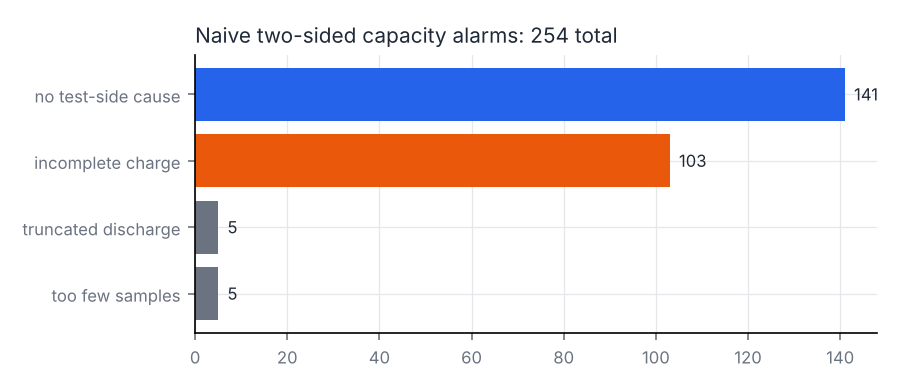
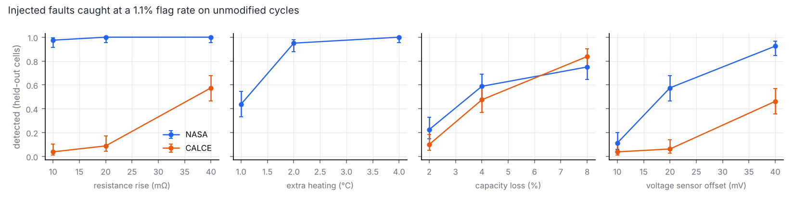
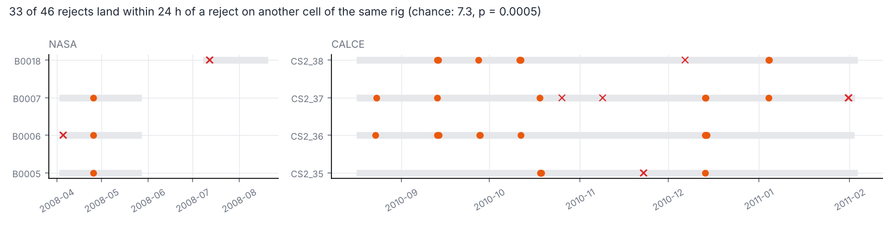
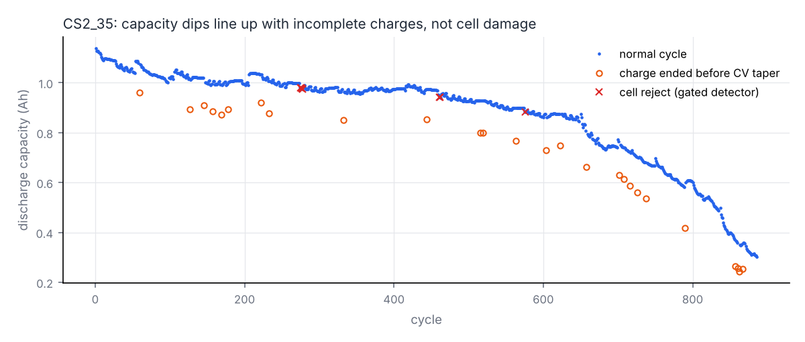

# Li-ion Cell Signal Diagnostics and Outlier-Rejection Criteria

[](https://github.com/ByteBoss123/cell-signal-diagnostics/actions/workflows/ci.yml)

Per-cycle diagnostic signals (capacity, mean voltage, DC resistance, temperature rise) are computed in SQL
from 3.2 million raw telemetry samples of 8 real Li-ion cells (NASA PCoE B0005/6/7/18 and CALCE CS2_35 to 38).
A context-aware detector decides which cycles to reject. It is then tested by injecting known faults into
held-out cells and checking how often each one is caught.

The question it answers: **when a cell signal moves, is it the cell or the test?**

## Results

| | |
|---|---|
| Telemetry | 3,208,363 samples, 8 cells, 2 labs, 4,557 cycles |
| Signal check | Coulomb-counted capacity matches the instrument's own value to a median 7.6 mAh (NASA) and 9.2 mAh (CALCE) over 4,541 cycles; NASA step-load DC resistance correlates with EIS impedance at r = 0.835 (579 pairs) |
| Naive SPC | A plain two-sided capacity chart raises 254 alarms. 113 fall on cycles with a test-side cause (103 incomplete charges, 5 truncated discharges, 5 with too few samples) and 2 more follow a long rest |
| Incomplete charges | All 108 cycles whose charge ended before the CV taper show a capacity dip (median 0.12 Ah short) |
| False-reject rate | Threshold tuned to 1% on 4 calibration cells; on the 4 held-out cells it is 1.1% (95% CI 0.7% to 1.6%) |
| Common cause | 33 of 46 rejects land within 24 h of a reject on another cell of the same rig, against 7.3 expected by chance (permutation p = 0.0005): most rejects point to the rig, not the cell |



### Injected-fault detection on held-out cells

160 clean cycles from the held-out cells, 1,680 injected variants. Faults are applied to the raw samples and
the signals are recomputed with the same SQL used on real data, so detection is measured end to end.
Detection rate (95% Wilson CI):

| Fault | Size | NASA | CALCE |
|---|---|---|---|
| Resistance rise | 10 / 20 / 40 mΩ | 98% / 100% / 100% | 4% / 9% / 58% |
| Extra self-heating | 1 / 2 / 4 °C | 44% / 95% / 100% | no cell thermocouple |
| Capacity loss | 2 / 4 / 8 % | 23% / 59% / 75% | 10% / 48% / 84% |
| Voltage sensor offset | 10 / 20 / 40 mV | 11% / 58% / 93% | 4% / 6% / 46% |

Full table with intervals: `outputs/tables/injection_detection.csv`.





## How it works

1. **Ingest** (`cellsig ingest`): NASA `.mat` and CALCE Arbin `.xlsx` files are parsed into one telemetry schema
   and staged as Parquet. Duplicate CALCE workbooks (same content under two names) are detected by content hash and dropped (2 found).
2. **Warehouse** (`warehouse.py`): DuckDB raw -> staging -> `mart_cycle_signals`. Every signal is computed in SQL
   from samples, so the mart can be rebuilt and audited.
3. **Quality gates** (`quality.py`): 5 critical checks stop the run (duplicate samples, duplicate cycles, missing
   capacity, quarantine share, capacity disagreeing with the instrument by more than 2% of rated). 15 physically impossible
   samples (sensor glitches such as 8.4 V or 0 V readings) are quarantined, not silently dropped.
4. **Context rules** (`detect.py`): incomplete charge, truncated discharge and too-few-samples cycles are labelled
   and kept out of both the baseline and the reject list.
5. **Detector**: causal Theil-Sen baseline over the last 20 accepted cycles, rolling-MAD noise scale with a per-signal
   floor, adverse direction only. A cycle is rejected when its worst z exceeds k = 4.15, chosen on calibration cells only.
6. **Common cause** (`common_cause.py`): rejects shared across cells of one rig within 24 h, with a permutation test that
   rotates each cell's reject times inside its own test span.
7. **Fault injection** (`inject.py`): capacity fade, resistance rise, voltage-sensor offset and self-heating, each at
   three sizes, on held-out cells.

## Limitations

- 8 cells from 2 labs. The detection rates describe these cells and these fault models, not a vehicle fleet.
- In most CALCE cycles the first loaded sample sits exactly 0.200 V below rest (consistent with a voltage-change logging
  trigger), so the DC resistance proxy is unusable there (1,024 cycles). That is why CALCE resistance and voltage-offset
  detection is low.
- CALCE cells have no cell thermocouple, so the thermal fault is NASA only.
- Injected faults are physically motivated but simple. Real defects can combine several at once.

## Changes after the first run

- Tried keeping the 5 cycles after a long rest out of the baseline (`rest_recovery_cycles: 5`). It lowered calibration
  detection from 55% to 46%, so it is off (0).

## Reproduce

```bash
pip install -e ".[dev]"
scripts/fetch_data.sh                 # pinned commit of a public mirror; every file checked against data/raw_manifest.sha256
cellsig ingest
cellsig run                           # about 15 s; writes outputs/metrics.json, tables, run_manifest.json
cellsig figures
pytest                                # 21 tests, including a golden regression on the real data
```

`outputs/run_manifest.json` records the parameter hash, the hash of every staged file and every quality-check result.

`tableau/cell_signal_diagnostics.twb` is a Tableau workbook over `outputs/tables` (capacity by cycle, detector score,
naive alarms by cause, injected-fault detection), validated against the Tableau 2026.2 schema.

## Data

- NASA Prognostics Center of Excellence, Li-ion Battery Aging Datasets (B. Saha and K. Goebel).
- CALCE Battery Research Group, University of Maryland, CS2 cells.

Raw data is not redistributed here. `scripts/fetch_data.sh` downloads it.
